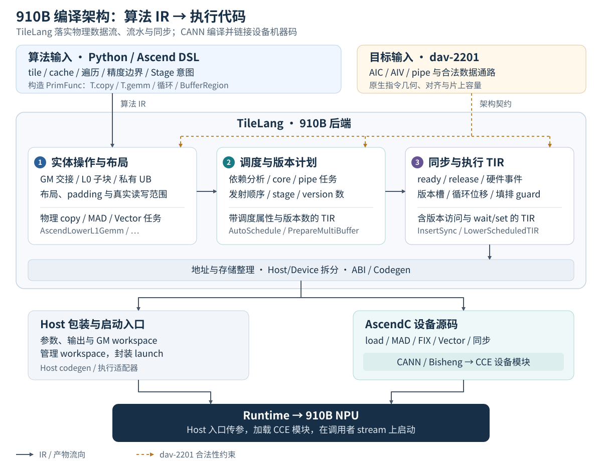

# 从 TileLang Python 到 910B：完整编译流程

本文面向能读懂 GEMM、attention Python 实现，但还不熟悉编译器的开发者。
先用数据流解释每一步解决什么问题，再对应到实际 pass 和源码。
[第 10.2 节](#dense-mha-compilation) 用同一次 dense MHA 编译对照关键 IR 的变化。
范围是当前 `dav-2201` 的普通 AscendC 后端；950、PTO 有各自的能力和执行路径。
精确合法性以[编译器契约](ascend_910b.md)及源码为准，测量结果见
[GEMM 与 dense MHA 性能报告](../ascend/910b_performance.md)。

## 1. 编译器逐步补齐哪些信息

编译输入是一份带算法策略的 PrimFunc：`T.copy` / `T.gemm` 声明逻辑操作，
buffer scope 与有效区域声明数据位置和范围，循环与注解声明遍历、流水意图。
tile 大小、cache 策略、累加顺序和精度边界来自 Python；后端沿这些语义补齐
物理数据流、调度计划、完成关系，最终形成设备指令与 host 启动接口。



图按职责归并 pass，实线表示 IR / 产物流向，虚线表示各阶段共同遵守的目标约束。
完整 pass 顺序见 [pipeline.py](../../tilelang/ascend/pipeline.py)。

以第 10 节的 GEMM 和 MHA 为例，每个边界都有可以在 IR 中检查的具体变化：

| 编译边界 | 补齐的信息 | 实例中可见的变化 |
| --- | --- | --- |
| 逻辑操作 → 物理数据流 | 原生子块与 scratch、布局、真实读写范围、AIV ownership | GEMM 的 K256 panel 展开成四次 K64 MAD；MHA 的 Score 经 GM 交给两个 AIV 的私有 UB |
| 物理任务 → 调度计划 | 读写依赖、core / pipe 归属、发射顺序、stage、版本数 | GEMM 的装入 / MAD / 导出选中外层 stage 0 / 1 / 2，L1 与 L0 operands 各用两槽 |
| 调度计划 → 执行 TIR | ready / release 完成边、事件分配、版本轴、位移后的循环和 guard | load 等旧 operand 的 reader 完成；最后 MAD → FIX → 下一输出 clear，地址与事件随 stage 一起位移 |
| 执行 TIR → Host / Device 产物 | 地址与存储整理、函数拆分、参数和 launch ABI、指令生成 | 设备侧产生带 load / MAD / FIX / wait 的 ASC；host 侧接收参数、管理 workspace 并封装启动 |

`dav-2201` 的容量和数据通路在这些阶段持续约束实现：L0 子块要符合原生几何，
增加版本后仍要装得下，跨 AIC/AIV 的逻辑 copy 要展开为该架构支持的 GM 交接。
调度得到的 stage 和版本数还需经过同步与实体化，才成为实际循环、地址与 wait/set。

TileLang 输出 ASC 后，CANN/Bisheng 按 `dav-2201` 编译并链接设备机器码；
运行时把设备模块与 host 入口接起来，在调用者 stream 上启动 kernel。
因此 ASC 中已经出现的重复搬运或串行依赖可以沿 IR 向前追踪，设备机器指令
的生成则需要继续查看 CANN 产物。第 10 节展示这些边界，第 12 节给出导出方式。

几个贯穿全文的术语：

| 术语 | 含义 | 例子 |
| --- | --- | --- |
| 逻辑 tile | 算法一次处理的数据块 | 128 行 query、1024 个 key |
| 物理 tile | 某次原生指令能实际处理的块 | 将逻辑 QK 的 N 维拆成多个 chunk |
| task | 调度器识别的操作单元 | 一次搬运或一组同 pipe 操作 |
| pipe | 能异步工作的执行流水 | MTE2、MTE1、M、V、FIX、S |
| stage | task 相对逻辑迭代的流水偏移 | 当前 QK 与前面 task 的 UpdateO 重叠 |
| version | 同一 buffer 的多份物理槽位 | load 下一块时保留正在被计算的一块 |
| epoch | 某个循环/计数域内的一代操作 | 第 t 个 task、第 c 个 chunk |
| owner | 数据或版本归属的执行者/循环域 | AIV 0 的私有行、内层 chunk 的 V 槽位 |

## 2. 先认识 910B 上的数据通路

910B 混合 kernel 的一个 group 包含一个 AIC 和两个 AIV。
AIC 负责 Cube 矩阵计算，AIV 负责向量运算。两个 AIV 各有私有 UB。

| 存储 | 当前目标容量 | 主要用途 |
| --- | ---: | --- |
| GM | 设备全局内存 | 输入输出、跨核中转、较大的状态 |
| L1 | 每 AIC 512 KiB | Cube 输入缓存 |
| L0A / L0B | 每 AIC 各 64 KiB | MAD 的两侧操作数 |
| L0C | 每 AIC 128 KiB | FP32 矩阵累加结果 |
| UB | 每 AIV 192 KiB | 向量输入、输出、归约临时量 |

表中片上容量来自当前目标描述
[target_utils.cc](../../src/ascend/target_utils.cc) 的 `GetAscendTargetInfo`；
它们是编译器使用的容量上限，不是性能测量或延迟模型。

GEMM 的典型路径是：

```text
GM ──MTE2──> L1 ──MTE1──> L0A/L0B ──M──> L0C ──FIX──> GM
```

Vector 侧典型路径是 GM → UB → 向量计算 → GM。
这里的箭头表示数据流；具体任务的 pipe 以指令和读写存储为准。
AIC 的 MTE2 和 AIV 的 MTE2 是不同资源，调度器使用 `(core, pipe)` 区分。

910B 没有可供这里使用的直接 L0C→UB、L1→UB 通路；逻辑 UB→L1 交接也需要
软件 GM 中转。这是 attention 必须认真安排交接和重叠的原因之一。
两个 AIV 的 UB 容量不能相加后给单个 AIV 使用。

## 3. Python 前端：算法策略变成可分析的 IR

入口使用 Ascend 方言并固定目标：

```python
from tilelang.ascend import language as T

target = {"kind": "ascend", "arch": "dav-2201"}
```

不显式指定架构时，环境变量可以提供默认值；没有环境默认值时是 `dav-3510`。
因此分析 910B 时应始终明确写出目标。

`@T.prim_func` 构造 TVM PrimFunc，包含参数、buffer、循环、条件、区域操作和注解。
工厂参数决定 shape、dtype、tile 大小及启用哪些算法分支；`T.macro` 展开算法片段。
这些 Python 构造不会在设备上成为 Python 解释器调用。

例如 GEMM 的核心表达是：

```python
# 示意片段：完整定义见 examples/ascend/gemm_910b.py。
for ki in T.Pipelined(T.ceildiv(k, tile_k)):
    T.copy(A[mi * tile_m:(mi + 1) * tile_m,
             ki * tile_k:(ki + 1) * tile_k], a_l1)
    T.copy(B[ni * tile_n:(ni + 1) * tile_n,
             ki * tile_k:(ki + 1) * tile_k], b_l1)
    T.gemm(a_l1, b_l1, accumulator,
           transpose_B=True, clear_accum=ki == 0)
```

这里声明了逻辑搬运与计算，还没有写 L0 操作数、event ID 或预取槽位。
`T.copy` 保留区域，`T.gemm` 保留矩阵语义，后续阶段才能据此选择硬件实现。

Python 与编译器的职责可以这样划分：

| Python 明确给出的策略 | 编译器继续完成的事情 |
| --- | --- |
| 输出 tile 遍历、group 数、persistent 循环 | 对已有循环调度和生成启动代码 |
| QK/PV 分块、缓存 K/V、向量行粒度 | 物理子块、指令读写范围、资源检查 |
| softmax 更新顺序及 P 的转换 dtype | 按这些精度边界生成计算 |
| Stage 和可选的完整 issue 顺序 | 验证计划、补齐版本、生成同步及填排 |
| query 状态保存在哪里、按什么索引轮换 | 根据实际区域保护其依赖与生命周期 |

当前 GEMM 的 persistent 输出遍历由 Python 的 `num_cores` 路径明确表达。
编译器不会自动把任意一个“一 tile 一 block”的程序转换成相同的 persistent 算法。
性能报告使用 persistent 配置，工厂的 `num_cores=None` 默认值仍保留 grid 路径。

## 4. 硬件合法化：先让实际工作全部可见

真实 pass 顺序在 [pipeline.py](../../tilelang/ascend/pipeline.py)。下表保留关键顺序，
省略穿插的通用 Simplify 等整理步骤。

| 顺序 | Pass | 此时补齐的信息 |
| --- | --- | --- |
| 1 | `BindTarget`、`AscendValidateTarget` | 固定架构、拒绝不支持的输入能力 |
| 2 | `MaterializeKernelLaunch` | 将逻辑 launch 转成 Ascend 核网格 |
| 3 | `AscendLowerGMHandoff`、`RewriteDualCopy` | 真实中转 buffer、copy 和参与者 |
| 4 | `AscendLowerL1Gemm` | 原生 L0 分块、搬运和 MAD 操作 |
| 5 | `AscendLowerMixedPartition` | 双 AIV 私有行域及本地容量 |
| 6 | `AscendLayoutInference`、`ReducerPlanAndMaterialize` | 物理布局和归约计划 |
| 7 | `NormalizeAscendFractalStorage`、`InsertNd2Nz` | 分形存储及转换操作 |
| 8 | `AscendInsertOOBPadding`、`AscendNormalizeCubeCopyFootprints` | 尾块填充、指令真正访问的范围 |
| 9 | `AscendSelectCubeLoads` | 合法场景下选择原生 load 形式 |
| 10 | `AscendLowerVectorReduce`、`AscendLowerVectorTiles` | 原生向量任务、临时 UB 和 effects |

### 4.1 为什么 GM 中转要早做

假设算法写的是“把 QK 的 L0C 结果交给 softmax 的 UB”。硬件实际需要：

```text
L0C → group 独立的 GM workspace → 两个 AIV 各自的 UB
```

编译器必须在调度前看到这两次搬运和 workspace，才能分析谁写、谁读、何时覆写。
若直到 codegen 才悄悄插入中转，前面算出的容量、依赖和流水计划都会缺少实际操作。
UB→L1 的 P 交接同理。中转保留有效区域，padding 容量不会自动变成有效输入。

### 4.2 一个 T.gemm 为什么产生多个 MAD

L1 中的一块矩阵可能超过 L0 操作数容量，逻辑累加矩阵也可能超过 L0C 容量。
`AscendLowerL1Gemm` 将可支持的模式拆成有界物理 M/N tile 和 sub-K 循环，
显式分配 L0A/B/C，并暴露相应 load、MAD 与 export。

于是调度器分析的是实际工作，而非给一个很大的黑盒 GEMM 猜一个耗时。
拆分仍要保留累加初始化、K 顺序和完整结果导出；不能仅凭能装下就任意改变数学过程。

### 4.3 布局与 padding 为什么影响同步

逻辑二维索引不等于片上物理字节顺序。例如 L1 的 NZ 与原生 L0A 的 ZZ 不同。
此外 LoadData2D 等指令可能读取完整 fractal，包括逻辑尾部之外的 padded lanes。

因此先推导布局、生成合法 padding 写入，再把整块指令 footprint 暴露给依赖分析。
否则分析只看到有效元素，可能漏掉实际覆盖的字节，错误地允许两个操作共用存储。
后面的 codegen 使用同一套 footprint 规则，不再独立猜一遍可读范围。

### 4.4 Vector 与归约也必须暴露真实工作

`T.Parallel` 和归约在 2201 上降低成原生 MemBase 向量任务，包含明确的临时 UB
和读写 effects。这样 reduce 的 scratch、类型转换和广播都进入容量与依赖分析。
3510 的 VF 路径有不同规则，不能直接搬来解释 2201 的执行。

## 5. 从语句变成任务、依赖和资源约束

随后执行 `AscendSelectFixpipeConfig`、控制流与冲突提示规范化，
再由 `MaterializeScheduleUnits`、`AnnotateMultiBufferEligible`、`EstimateLatency`
准备调度输入。

调度器内部用树表示 kernel：叶子是 task，控制节点保留循环和条件的边界。
[ScheduledTIR](../../src/ascend/transform/auto_schedule/scheduled_tir.h)
负责这些调度信息与 TIR 之间的编码；控制头本身的内存访问也有自己的 owner。

[依赖分析](../../src/ascend/transform/auto_schedule/dependency_analysis.cc)
结合区域、条件和迭代坐标判断冲突：

| 类型 | 简单例子 | 必须保证的顺序 |
| --- | --- | --- |
| RAW：写后读 | load A，然后 MAD 读 A | 数据写完才能读 |
| WAR：读后写 | MAD 仍读旧 A，load 要覆盖同槽 | 旧读完成才能覆盖 |
| WAW：写后写 | 两代输出复用同一地址 | 保留正确的写入顺序 |

距离为零的依赖在同一逻辑迭代内，跨迭代依赖还携带 distance。
分析会考虑两个访问是否可能落在同一物理 owner 和同一区域。
一个冲突只说明需要顺序，尚未证明某条硬件事件足以覆盖全部实际读者。

版本资格同样需要 owner。例如每次 chunk 都重新装入的 V 可以属于 chunk 循环；
跨多个 KV tile 累积的 query 状态有更长生命周期，不能看到循环内写入就给它按
每次 task 自动轮换。

## 6. AutoSchedule：选择合法重叠方式

自动流水同时选择操作 issue 顺序、stage 和 buffer 版本数。
它要满足数据依赖、pipe 资源、存储容量、owner 完成和显式用户约束。
增加版本可能允许更多重叠，也会占用更多 L1/L0/UB；这些决策必须一起求解。

当前 2201 的 `EstimateLatency` 使用无量纲 service weights。
求解器中的 II 是计划重复的间隔，其单位来自这个模型；不能将它当成真实设备周期，
也不能根据模型 II 下降就宣布 kernel 加速。代价模型与合法性约束是两回事。

三种模式共享后续验证：

| 模式 | 用户固定什么 | 编译器可以选择什么 |
| --- | --- | --- |
| 普通 `T.Pipelined(...)` | 算法与循环边界 | 顺序、stage、版本数 |
| Stage-only | 显式 stage、各 pipe 内源顺序 | 跨 pipe 排步及未固定版本 |
| 完整手排 | stage 和完整 outer issue 顺序 | 确定性补齐未指定版本、验证计划 |

Ascend 方言省略 `num_stages` 时启用自动选择，默认 `max_stages=4` 是搜索上限，
不等于实际分配四份 buffer。显式正 `num_stages` 是物理版本数上限，
不限制 `T.Stage` 的最大值；非零 stage 需要 `enable_offset=True`。
显式零保留串行默认、关闭该自动流水选择，因此当前手排采用正上限。

完整手排示意：

```python
for task in T.Pipelined(
    tasks, num_stages=3,
    annotations={"enable_offset": True,
                 "tl.ascend_preserve_issue_order": True},
):
    with T.Stage(0):
        qk(task)       # 示意函数，实际代码含多个原生任务
    with T.Stage(1):
        softmax(task)
        pv(task)
    with T.Stage(2):
        update_o(task)
```

四个算法 phase 使用三个 stage，stage 数、phase 数和 buffer 版本数各有含义。
完整 outer 手排仍可包含独立的自动 PV 内循环。
关闭全局 `TL_ENABLE_AUTO_SCHEDULE` 会跳过整段调度/自动同步流水；它不是选择完整
手排的方法。三种模式的完整边界见[调度契约](ascend_910b_scheduling.md)。

## 7. 版本、核分配与同步为什么分阶段

实际顺序为：

```text
AutoSchedule → AssignCore → PrepareMultiBuffer → ResolveCore
             → InsertSync → MaterializeMultiBuffer → LowerScheduledTIR
             → RestoreWhileLoops
```

`AssignCore` 确认任务所属核，`PrepareMultiBuffer` 准备已选版本的 epoch 和计划，
`ResolveCore` 形成具体核执行流。到此时，同步分析知道“哪个执行者的哪一代数据”
要交给谁，但高层循环和任务边界仍在。

### 7.1 InsertSync 要回答的三个问题

1. **值可读吗？** 生产者写完，相关消费者才可开始。
2. **槽位可覆盖吗？** 全部旧读者完成，新生产者才能写入。
3. **通知本身可复用吗？** 上一轮事件被正确消费后，有限的 event ID 才能服务下一轮。

这三件事有不同证据。例如一个 AIV 读完不代表另一个也读完；Scalar 发出下一条
指令不代表先前 Vector 已完成；同一个 event ID 可再次使用不代表关联内存可覆盖。
真实匹配的 V→S wait 可以证明它覆盖的 Vector 工作完成，但从 Scalar 消费事件
推导出的 flag 复用关系不能扩展成任意 Vector 数据完成关系。

一个双槽例子：

```text
load(t) 写 slot[t % 2] → MAD(t) 读这个槽
MAD(t) 的完整读完成   → load(t + 2) 才能覆盖这个槽
```

第一条是 ready，第二条是 release。只生成第一条，会在流水绕回槽位时产生竞争。
若一次逻辑数据供多个 MAD 或两个 AIV 使用，release 必须覆盖最后一个相关读者。

当前入口将工作分成准备、`PlanKernelSync` 和 `MaterializeKernelSync`。
计划阶段分析依赖覆盖、事件生命周期和物理 ID 容量，必要时撤回未获证明的优化候选
并重新分析；materializer 只把成功计划写回 IR。
重试保留合法性检查，不用额外 barrier 掩盖缺失的证明。

大部分复杂度来自嵌套循环、guard、父子 epoch、双 AIV collective 和存储 alias
共同作用。逐项阅读可转到[同步算法说明](ascend_910b_insert_sync.md)，其中解释了
site、闭包、生命周期状态和 ID 分配，不需要先读完整个 `insert_sync.cc`。

### 7.2 为什么物理版本地址与 stage 位移在同步之后生成

在逻辑任务树里，编译器还能识别 producer/consumer 属于同一 task 的哪一代。
先拍平成地址和带偏移的循环，会让这些关系更难恢复。
因此 `MaterializeMultiBuffer` 根据已验证计划落实物理版本，
`LowerScheduledTIR` 再一起位移 task 索引、访问、guard 和同步，并展开填排区间。

以非负 stage 0/1/2 的简化模型为例，物理迭代 p 分别处理逻辑 task
p、p−1、p−2。开头后一部分尚未有效，末尾仍要排空前面发出的工作。
编译器同时生成范围 guard 和对应版本索引。
该示意略去了实际计划的原点归一，但说明了为什么不能只移动计算而不移动 wait/set。

## 8. 后半段：从计划落实到地址与 ASC

调度后的主要整理包括：

| 阶段 | 作用 |
| --- | --- |
| `NormalizeBufferVersion`、`AscendLowerTileOp` | 将剩余版本与 tile 操作转成低层表示 |
| access pointer、类型与安全访问 lowering | 将区域语义落实到参数、指针、类型和边界 |
| `HoistGlobalBufferAllocations` | 提取需要 host 管理的 GM workspace |
| `RewriteAscendBufferVersionLayout`、`FlattenBuffer` | 落实版本布局、线性地址及偏移 |
| 循环、条件和空操作整理 | 消除降低后可证明的冗余 |
| `SplitHostDevice` | 分离 host 启动逻辑与设备函数 |
| `MergeUBAllocations` | 按允许的复用关系、对齐和容量组织物理存储 |
| `RewriteFlagToBuf` | [实现](../../src/ascend/transform/rewrite_flag_to_buf.cc)在 2201 压紧各核的八 ID hard-event 命名空间，超限则诊断；mutex spill 属于 3510 路径 |
| `MakePackedAPI`、`LowerDeviceKernelLaunch` | 形成运行时可调用的 ABI 与 launch |

后面的 flag 整理不替代 InsertSync 的数据与生命周期证明。
非自动调度路径另外调用 `InferBufferAliases`；不能把这条分支理解为任意复用授权。
具体通用 pass 和条件分支仍以 `pipeline.py` 为准。

[codegen_ascend.cc](../../src/ascend/codegen/codegen_ascend.cc)
消费已经确定的布局、核区域、同步与地址，输出 AscendC 指令和相关模板调用。
此时不会重新选择 attention tile、重新给两个 AIV 分行或重新寻找流水 stage。
检查生成代码时，应能从每段 load、MAD、FIX、Vector 和 wait/set 追溯到前面的任务。

## 9. CANN 编译、缓存和运行时

[backend.py](../../tilelang/ascend/backend.py) 注册普通 Ascend 后端，连接 lowering、
codegen、执行适配器和设备编译回调。默认执行适配器优先选择 `tvm_ffi`，也支持
`cython`；两者 host 包装方式不同。

普通设备编译回调把 ASC 交给 [bisheng.py](../../tilelang/contrib/bisheng.py)，
使用显式架构及编译参数，生成可重定位 CCE ELF 后进行设备链接。
宿主侧也有自己的模块/包装产物；缓存里的 `executable.so` 不应简单等同于原始 ASC
文本或所有后端共用的单一设备文件格式。

缓存有不同层次：完整 kernel 缓存保存接口及源码/执行产物，设备二进制缓存复用
相同代码、目标架构和编译/链接选项对应的 CANN 结果。
因此核对改动时，要记录产品源码、实际导入的 Python、加载的 `libtilelang.so`
以及最终 ASC/机器码身份。只看工作树或文件时间无法确认执行的是本轮实现。

Host 包装接收 tensor、处理输出和 workspace，并通过运行时启动设备函数。
2201 的编译器自有 GM workspace 起始地址按 512 字节对齐：分配额外空间、传入
对齐后的内部指针，释放时仍使用原 allocation handle。
生命周期与 stream 所有权走已有运行时路径，不要求用户每次手动创建中转 tensor。
外部 tensor 的地址及 stride 仍由调用者提供。

`tilelang.lower` 可以只生成代码，也可显式启用设备编译；生成 ASC、完成 CANN
离线编译和实际运行 kernel 是不同步骤。编译成功证明工具链接受产物，设备正确性
与性能仍需分别验证。

## 10. 用 GEMM 和 dense MHA 串起整条链路

### 10.1 GEMM：一个输出 tile 的生命周期

完整 Python 在 [gemm_910b.py](../../examples/ascend/gemm_910b.py)，参数与同步
契约见[连续 GEMM 文档](ascend_910b_gemm.md)。设置 `num_cores` 后，默认
`pipeline_outputs=False` 用 serial 输出循环包住每个 tile 的自动 K 流水；下面展开[性能报告](../ascend/910b_performance.md)
采用的 `pipeline_outputs=True`，将每核的输出与 K panels 放进一个连续自动循环。

固定 BF16 NT GEMM `C=A@B.T`、M512/N1024/K1024、逻辑 tile 128×256×256，
用 4 个 AIC 分配 16 个输出 tiles。示例从产品仓库根目录执行：

```python
import importlib.util
from pathlib import Path

spec = importlib.util.spec_from_file_location(
    "gemm_910b", Path("examples/ascend/gemm_910b.py")
)
gm = importlib.util.module_from_spec(spec)
spec.loader.exec_module(gm)
program = gm.gemm(
    512, 1024, 1024, dtype="bfloat16", transpose_b=True,
    tile_m=128, tile_n=256, tile_k=256,
    num_cores=4, pipeline_outputs=True,
)
```

下面是这组 PrimFunc 实际 `dav-2201` 编译的关键片段，可复用第 12 节导出代码。
只保留输出生命周期所需的 IR；省略处均有标注。

#### 10.1.1 前端：输出 tile 与 K panel 共用 task 时钟

每核处理 4 个输出，每个输出有 4 个 K256 panels，共 16 个逻辑 tasks。
前端 IR 已包含领取规则、首 panel 清零和末 panel 导出：

前端 IR（节选）：

```python
for task in T.serial((16 - bx + 4 - 1) // 4 * 4, annotations={"num_stages": 4, "tl.ascend_auto_pipeline": True}):
    tile_id: T.int32 = bx + task // 4 * 4
    mi: T.int32 = tile_id // 4
    ni: T.int32 = tile_id % 4
    ki: T.int32 = task % 4
    T.ascend_copy(T.region(A[mi * 128, ki * 256], 1, 128, 256), T.region(a_l1[0, 0], 2, 128, 256))
    T.ascend_copy(T.region(B[ni * 256, ki * 256], 1, 256, 256), T.region(b_l1[0, 0], 2, 256, 256))
    T.gemm(T.region(a_l1[0, 0], 1, 128, 256), T.region(b_l1[0, 0], 1, 256, 256), T.region(accumulator_1[0, 0], 3, 128, 256), T.bool(False), T.bool(True), 128, 256, 256, 0, ki == 0, 0, 0, 0)
    if ki == 3:
        T.ascend_copy(T.region(accumulator_1[0, 0], 1, 128, 256), T.region(C[mi * 128, ni * 256], 2, 128, 256))
```

`task//4` 选择本核的输出，`task%4` 选择其 K panel。例如 `bx=0` 的 tasks 0–3
累加输出 tile 0，tasks 4–7 累加 tile 4；每个输出只在 `ki=0` 清零、`ki=3` 导出。
Python 尚未指定物理 L0 scratch、版本槽或事件；`num_stages=4` 是自动搜索上限。

#### 10.1.2 硬件展开：一次 K256 GEMM 变成四次 K64 MAD

`AscendLowerL1Gemm` 新建 L0A `[128,64]`、L0B `[256,64]`，把每个 L1 panel
拆成四个 sub-K。这个配置不需要再拆 M/N，L0C 始终是 `[128,256]` 的 FP32 tile：

AscendLowerL1Gemm 后的 IR（节选）：

```python
for gemm_sub_k_0 in T.serial(4, annotations={"num_stages": 4, "tl.ascend_auto_pipeline": True}):
    T.ascend_copy(T.region(a_l1[0, gemm_sub_k_0 * 64], 1, 128, 64), T.region(gemm_l0a_0[0, 0], 2, 128, 64))
    T.ascend_copy(T.region(b_l1[0, gemm_sub_k_0 * 64], 1, 256, 64), T.region(gemm_l0b_0[0, 0], 2, 256, 64))
    T.gemm(T.region(gemm_l0a_0[0, 0], 1, 128, 64), T.region(gemm_l0b_0[0, 0], 1, 256, 64), T.region(accumulator_1[0, 0], 3, 128, 256), T.bool(False), T.bool(True), 128, 256, 64, 0, task % 4 == 0 and gemm_sub_k_0 == 0, 0, 0, 0)
```

clear 条件变为 `task%4==0 and gemm_sub_k_0==0`，因此只有一个输出的第一条
MAD 清零；其余 15 条 MAD 继续累加同一份 L0C。四个 panels 全部完成后才导出，
物理 sub-K 没有增加结果导出或 BF16 舍入点。
后续布局与 load 选择把这些 copy 落实为 GM→L1 的 ND→NZ 搬运，以及
L1→L0A 的 Load3D、L1→L0B 的原生 operand load。

#### 10.1.3 调度与版本：保留正在消费的 operand

本次 AutoSchedule 选择如下外层偏移；内层 sub-K 的 load/MAD 使用自己的
相对 stage 0。LowerScheduledTIR 再把外层 stage 写成实际 task 坐标与边界 guard：

| 外层 stage | 工作 | 填排后循环坐标为 task 时，处理的逻辑 panel |
| --- | --- | --- |
| 0 | GM→L1 装入 A/B | task |
| 1 | 内层 sub-K load 与 MAD | task−1 |
| 2 | 条件 L0C→GM 导出 | task−2 |

因此填排后的循环有 18 步：装入只在 task<16 执行，MAD 只在 1≤task<17 执行，
导出阶段从 task=2 开始。Stage 注解确定操作属于哪一代 panel，不能只按降低前
语句的打印顺序判断执行次序。

AutoSchedule 为两侧 L1/L0 operands 各选两版本，MaterializeMultiBuffer 将其
写成显式版本轴；累加器保留一份，跨同一输出的四个 panels 存活：

MaterializeMultiBuffer 后的分配 IR（省略 strides）：

```python
a_l1_1 = T.sblock_alloc_buffer((2, 128, 256), 'bfloat16', data=a_l1.data, scope='shared.l1')
b_l1_1 = T.sblock_alloc_buffer((2, 256, 256), 'bfloat16', data=b_l1.data, scope='shared.l1')
accumulator = T.sblock_alloc_buffer((128, 256), data=accumulator.data, scope='shared.l0c')
gemm_l0a_0_1 = T.sblock_alloc_buffer((2, 128, 64), 'bfloat16', data=gemm_l0a_0.data, scope='shared.l0a')
gemm_l0b_0_1 = T.sblock_alloc_buffer((2, 256, 64), 'bfloat16', data=gemm_l0b_0.data, scope='shared.l0b')
```

按实际分配，本例占 L1 384 KiB、L0A 32 KiB、L0B 64 KiB、L0C 128 KiB。
L1 槽按 panel 时钟轮换，L0 槽按连续 sub-K generation 轮换；两槽只提供存储，
允许何时覆盖还需要下一步的 reader completion 证明。

#### 10.1.4 同步与导出：读完才覆盖，FIX 完成才复用 L0C

InsertSync 建立 operand ready/release 与累加器完成关系，再与版本地址一起位移。
下面是 LowerScheduledTIR 后的一段：此时 MAD 消费逻辑 panel `task-1`，
L1 用 `(task-1)%2` 选槽，L0 用 `(gemm_sub_k_0+(task-1)*4)%2` 选槽。

LowerScheduledTIR 后的 IR（节选，省略外围 loop/guard）：

```python
T.ascend_wait_flag("M_MTE1", (gemm_sub_k_0 + (task - 1) * 4) % 2)
T.ascend_cube_load3d(T.region(a_l1_1[(task - 1) % 2, 0, gemm_sub_k_0 * 64], 1, 1, 128, 64), T.region(gemm_l0a_0_1[(gemm_sub_k_0 + (task - 1) * 4) % 2, 0, 0], 2, 1, 128, 64), 128, 256)
if gemm_sub_k_0 + 1 >= 4:
    T.ascend_set_flag("MTE1_MTE2", (task - 1) % 2 + 2)
# … 中间语句省略
if gemm_sub_k_0 == 0:
    T.ascend_wait_flag("FIX_M", 0)
T.ascend_wait_flag("MTE1_M", (gemm_sub_k_0 + (task - 1) * 4) % 2)
T.gemm(T.region(gemm_l0a_0_1[(gemm_sub_k_0 + (task - 1) * 4) % 2, 0, 0], 1, 1, 128, 64), T.region(gemm_l0b_0_1[(gemm_sub_k_0 + (task - 1) * 4) % 2, 0, 0], 1, 1, 256, 64), T.region(accumulator[0, 0], 3, 128, 256), T.bool(False), T.bool(True), 128, 256, 64, 0, (task - 1) % 4 == 0 and gemm_sub_k_0 == 0, 0, 0, 0)
T.ascend_set_flag("M_MTE1", (gemm_sub_k_0 + (task - 1) * 4) % 2)
if gemm_sub_k_0 + 1 >= 4:
    T.ascend_set_flag("M_FIX", 0)
```

`M_MTE1` 保护旧 L0 operand 被 MAD 读完后才覆盖；最后一次 L1→L0 load
发出 `MTE1_MTE2`，允许后续 GM load 覆盖相应 L1 槽。`MTE1_M` 保证新 operand
可读，最后 sub-K 发出的 `M_FIX` 保证该 panel 的累加完成。
每个 panel 的第一条 MAD 还等待 `FIX_M`；跨输出时，这条边保证旧结果导出完成，
下一输出才可以 clear 同一份 L0C。

对应的最终 ASC 保留这些完成边。导出处理 `task-2`，只在该输出的末 panel
执行实际 copy，局部 Fixpipe 配置使用 `ND_PARA=1`：

对应的 AscendC（节选）：

```cpp
if (2 <= task) {
  asc_sync_wait(PIPE_M, PIPE_FIX, static_cast<event_t>(0));
  if (((task + 2) & 3) == 3) {
    asc_set_l0c_copy_params(1, 0, 0);
    asc_sync_pipe(PIPE_FIX);
    asc_copy_l0c2gm((&(C[((((task - 2) >> 2) * 131072) + (((int32_t)block_idx) * 256))])), ((__cc__ float*)accumulator), 256, 128, 1024, 128, 0, 16, 0, 0, 1);
  }
  asc_sync_notify(PIPE_FIX, PIPE_M, static_cast<event_t>(0));
}
```

ASC 中的条件等价于 `(task-2)%4==3`，对应前端的末 panel 导出。
这里仍在每个 panel 周围执行 MAD/FIX 握手，条件满足时才真正写 C；连续输出循环
使用当前普通 C 同步契约。Codegen 将计划变成原生 load、MAD、FIX 和 wait/notify，
本例 ASC 已通过 CANN 离线编译。

可选 A cache 改变的是 Python 驻留策略；自动增加版本服务于流水重叠，
不会自行得到跨输出的 A cache 复用。

<a id="dense-mha-compilation"></a>

### 10.2 dense MHA：沿 persistent_910b.py 看实际 IR 的变化

完整算法在 [persistent_910b.py](../../examples/ascend/flash_attention/persistent_910b.py)，
参数契约见 [910b.md](../../examples/ascend/flash_attention/910b.md)。下面固定一组
D128 配置，对照前面的编译流程；各阶段使用同一个 PrimFunc。
示例代码从产品仓库根目录执行：

```python
import importlib.util
from pathlib import Path

example = Path("examples/ascend/flash_attention/persistent_910b.py")
spec = importlib.util.spec_from_file_location("persistent_910b", example)
fa = importlib.util.module_from_spec(spec)
spec.loader.exec_module(fa)

program = fa.persistent_attention_fwd(
    batch=1, heads=32, query_pairs=32, kv_tiles=8, groups=20,
    block_q=128, block_kv=1024, head_dim=128, dtype="bfloat16",
    row_block=8, row_block_vec2=64,
    qk_chunk=128, stream_qk_b=True, reuse_qk_b=True,
    pv_chunk=128, pv_rows=128, cache_pv=True, stream_pv_p=True,
    separate_score_input=True, inplace_final_division=True,
    preserve_issue_order=True,
)
```

这对应 B1/H32/Sq8192/Sk8192、20 个 mixed group。每组一个 AIC 加两个 AIV，
两个 AIV 各处理 128 行 query，AIC 为两个 query owner 计算 QK/PV：

| Phase | 本例实际工作 | 交给下一阶段的数据 |
| --- | --- | --- |
| QK | 每 owner 8 次 M128/N128/K128 MAD | FP32 Score `[128,1024]` |
| Softmax | 每 AIV 分 16 次处理 8×1024，整行归约 | BF16 P、FP32 alpha 和分母 |
| PV | 每 owner 8 次 M128/N128/K128 MAD，chunk0 清零 | FP32 PV `[128,128]` |
| UpdateO | 每 AIV 分两次处理 64×128 | FP32 累积状态，末 KV tile 归一化后写 BF16 O |

Softmax 与 UpdateO 的联系是在线递推。用 S 表示经过 `1/sqrt(128)` 缩放的
当前 Score，m/l/O 表示此前 KV tiles 的状态：

```text
m_new     = max(m, rowmax(S))
alpha     = exp(m - m_new)
p         = exp(S - m_new)
l_new     = l * alpha + rowsum(p)
O_new     = O * alpha + cast_bf16(p) @ V
最终输出   = cast_bf16(O_new / l_new)
```

因此 P 的舍入点、alpha 的传递和 query 状态的生命周期都是算法约束。
首 KV tile 初始化 m/l，UpdateO 直接用 PV 初始化 O；末 tile 才归一化输出。
下面的 IR 来自这组参数的实际 `dav-2201` 编译，只截取解释变化所需的语句；
省略调度属性或中间语句时会注明。完整 IR 可按第 12 节自行导出。

#### 10.2.1 前端 IR：三个循环时钟承担不同职责

`@T.prim_func` 已常量化参数、展开 Python 分支。外部 Q/O 是
`[1,32,32,2,128,128]` 的 paired-query 视图，K/V 是 `[1,32,8192,128]`；
Q/O 的视图仍对应连续的 BNSD 数据。前端循环 IR 是：

前端 IR（节选）：

```python
tasks: T.int32 = (1043 - bx) // 20 * 8
for t in T.serial(tasks, annotations={"enable_offset": True, "num_stages": 3, "tl.ascend_auto_pipeline": False, "tl.ascend_preserve_issue_order": True}):
    local_pair: T.int32 = t // 8
    flat_pair: T.int32 = bx + local_pair * 20
    batch_index: T.int32 = flat_pair // 1024
    head_index: T.int32 = flat_pair // 32 % 32
    query_pair: T.int32 = flat_pair % 32
    kv: T.int32 = t % 8
    query_slot: T.int32 = local_pair % 2
```

每个 pair 连续处理 8 个 KV tiles，`t%8` 选择 KV，`t//8` 选择本组的 pair。
`flat_pair=bx+local_pair*20` 将 1024 个 pairs 分给 20 组，前 4 组各 52 pairs，
其余各 51；三核使用同一组 task extent。pair 结束后直接进入下一 pair，
没有在 query 边界重新启动 kernel 或排空整个 task 流。

三种时钟不能合并：

| 数据 | 时钟 | 状态如何保留 |
| --- | --- | --- |
| Score/P/PV/alpha | task `t` | 每 KV tile 产生新一代，后续由编译器落实版本槽 |
| maximum/denominator/OState | local pair `t//8` | query slot 为 `(t//8)%2`，跨 8 个 KV tiles 累积 |
| QK K/L0B、PV L0A/B | 内层 `n` / `chunk` | 为原生 MAD 保留 operand generation |

例如 OState 在前端已有 query-slot 轴，而 Score/P/PV 还没有 task-version 轴。
两个 AIV 的 UB 也各自私有；`sid` 选择 query owner，不是在同一 UB 中选择版本。
query slot 取 local pair 的奇偶；flat pair 在本组每次加 20，其奇偶不能用于轮换。

#### 10.2.2 硬件展开：GM 交接与 PV 的 L0 operands

本例显式写出了 `score_acc→Score→score_input`、`probabilities→P→p_l1`
和 `pv_acc→PV→pv`。`AscendLowerGMHandoff` 保留这些实际 GM 路径，
`AscendLowerMixedPartition` 验证私有 UB 和两个 SID 的访问分区。
同一块 Score 的生产者和消费者使用不同方向的区域：

ownership 验证后的 Score 交接 IR（节选）：

```python
T.ascend_copy(T.region(score_acc_1[0, 0], 1, 128, 128), T.region(Score_1[bx, owner, 0, n * 128], 2, 1, 1, 128, 128))
# … 中间语句省略
T.ascend_copy(T.region(Score_1[bx, sid, sub * 8, 0], 1, 1, 1, 8, 1024), T.region(score_input_1[0, 0], 2, 8, 1024))
```

AIC 按 owner 写 128×128 的 N chunk；AIV sid 按自己的 owner 分区读 8×1024。
编译器由这些区域建立依赖，不能只按相同 buffer 名就把两段当成同一种访问。
`T.region` 的 mode 1/2/3 分别表示读、写、读写，后面的数是各轴访问长度。

QK 已显式使用 L0A/B，PV 前端仍以 L1 operands 调用 GEMM：

前端 PV GEMM IR（节选）：

```python
T.gemm(T.region(p_l1_1[0, 0], 1, 128, 128), T.region(v_l1_1[chunk * 128, 0], 1, 128, 128), T.region(pv_acc_1[0, 0], 3, 128, 128), T.bool(False), T.bool(False), 128, 128, 128, 0, chunk == 0, 0, 0, 0)
```

`AscendLowerL1Gemm` 增加实际 L0 buffers 和搬运，PV body 变成：

AscendLowerL1Gemm 后的 PV IR（节选）：

```python
for owner, part in T.grid(2, 1):
    for chunk in T.serial(8, annotations={"num_stages": 4, "tl.ascend_auto_pipeline": True}):
        T.ascend_copy(T.region(P_1[bx, owner, 0, chunk * 128], 1, 1, 1, 128, 128), T.region(p_l1_1[0, 0], 2, 128, 128))
        T.ascend_copy(T.region(p_l1_1[0, 0], 1, 128, 128), T.region(gemm_l0a_0[0, 0], 2, 128, 128))
        T.ascend_copy(T.region(v_l1_1[chunk * 128, 0], 1, 128, 128), T.region(gemm_l0b_0[0, 0], 2, 128, 128))
        T.gemm(T.region(gemm_l0a_0[0, 0], 1, 128, 128), T.region(gemm_l0b_0[0, 0], 1, 128, 128), T.region(pv_acc_1[0, 0], 3, 128, 128), T.bool(False), T.bool(False), 128, 128, 128, 0, chunk == 0, 0, 0, 0)
    T.ascend_copy(T.region(pv_acc_1[0, 0], 1, 128, 128), T.region(PV_1[bx, owner, 0, 0], 2, 1, 1, 128, 128))
```

现在每个 chunk 的 P→L0A、V→L0B 和 MAD 都可独立进入调度。
两个新增 operands 各为 32 KiB；每 owner 的 accumulator 是 64 KiB，
只在 chunk0 clear，8 个 chunks 完成后一次导出。每 task 的 QK/PV 各有
16 个原生 MAD，这些工作量由算法循环决定，不能仅靠调度注解改变。

#### 10.2.3 布局和 Vector lowering：把真实访问范围补齐

布局推导决定逻辑矩阵怎样落入 fractal 存储。以本例两份静态 Q 为例：

| buffer | 逻辑 shape | 物理索引 |
| --- | --- | --- |
| Q/L1 | `[2,128,128]` | `[owner,c//16,r//16,r%16,c%16]` |
| Q/L0A | `[2,128,128]` | `[owner,r//16,c//16,r%16,c%16]` |

二者物理 shape 都是 `[2,8,8,16,16]`，但前两个 fractal 轴顺序不同。
padding/footprint passes 进一步确定原生指令实际读写的字节范围。
本例矩阵对齐且完整，没有尾块 fill；QK 的转置 K load 走 LoadData2D，
Q/L0A 和 PV operands 则选择 Load3Dv2。这些选择在调度前确定。

Softmax 的 `T.reduce/T.Parallel` 随后降低为原生 MemBase 操作，
同时产生显式 UB scratch。exp、P 转换和分母归约的一段 IR 是：

AscendLowerVectorTiles 后的 Softmax IR（节选）：

```python
T.tl.ascend_membase.exp(T.access_ptr(scores_1[0, 0], 8192, 2), T.access_ptr(scores_1[0, 0], 8192, 1), T.uint32(8192))
T.tl.ascend_membase.float2bfloat16_rn(T.access_ptr(probabilities_1[0, 0], 8192, 2), T.access_ptr(scores_1[0, 0], 8192, 1), T.uint32(8192))
T.tl.ascend_membase.datablock_reduce_sum(T.access_ptr(membase_reduce_datablocks_3_1[0, 0], 1024, 2), T.access_ptr(scores_1[0, 0], 8192, 1), T.uint32(8192))
T.tl.ascend_membase.datablock_reduce_sum(T.access_ptr(membase_reduce_partials_2_1[0, 0], 128, 2), T.access_ptr(membase_reduce_datablocks_3_1[0, 0], 1024, 1), T.uint32(1024))
T.tl.ascend_membase.repeat_reduce_sum_rows_f32(T.region(row_sum_1[0], 2, 8), T.region(membase_reduce_partials_2_1[0, 0], 1, 8, 16), T.uint8(8), T.uint16(2), T.uint8(16))
```

这里 cast 写 BF16 probabilities，sum 仍读取 FP32 scores，正好对应前面的递推。
归约 scratch、广播和 destructive 更新的 effects 都进入依赖与容量分析，
后续才能判断哪些 Vector 操作需要局部完成、哪些独立区域可以重叠。

#### 10.2.4 调度：外层完整手排，PV 内层自动选择

`MaterializeScheduleUnits` 将真实操作包装为任务，eligibility 分析找出
可生成新一代数据的 owner；跨 KV 累积的 query 状态不会自动变成 task ring。
本例 outer 已通过 `preserve_issue_order=True` 固定完整顺序和 stage：

| Phase | 核 | outer stage |
| --- | --- | ---: |
| QK | AIC | 0 |
| Softmax | AIV | 1 |
| PV | AIC | 1 |
| UpdateO | AIV | 2 |

`AutoSchedule` 对 outer 做确定性版本补全和合法性验证；PV chunk loop
仍独立自动排步。本例 inner 顺序由 P load→A load→B load→MAD
变成 P load→B load→A load→MAD。其 MAD 的实际 metadata 是：

AutoSchedule 后的 PV MAD IR（节选）：

```python
T.attr({"stage": 0}, "tl.schedule_unit", 1)
T.attr({"core_mask": T.int64(2), "ii": T.int64(4), "latency": T.int64(4)}, "tl.ascend_task", 1)
T.gemm(T.region(gemm_l0a_0[0, 0], 1, 128, 128), T.region(gemm_l0b_0[0, 0], 1, 128, 128), T.region(pv_acc[0, 0], 3, 128, 128), T.bool(False), T.bool(False), 128, 128, 128, 0, chunk == 0, 0, 0, 0)
```

`core_mask=2` 表示 Cube，stage0 属于这个内层 loop；4/4 是模型权重。
本例 inner 各 child 都选 stage0，L0A/B 仍各有两槽。
Score/P/PV/alpha 和 QK L0B 的显式两版本保留，PV L0A/B 补为两版本。
outer 的 `num_stages=3` 是上限，不意味着所有 buffer 分三份。

随后 `AssignCore→PrepareMultiBuffer→ResolveCore` 确定核归属与版本时钟。
这时仍保留逻辑 task、guard 和 owner；InsertSync 使用它们证明同一代数据的
生产、消费和复用，物理地址尚未拍平。

#### 10.2.5 同步：最后一个读者决定槽位何时归还

QK 的 K/L0B chunk 供两个 query owner 使用。新 load 前等待旧 slot 的
MAD reader 完成，load 完成后再通知新 MAD；release 则位于 owner1 之后：

InsertSync 后的 L0 release IR（省略外围任务属性）（节选）：

```python
if owner == 1:
    T.ascend_set_flag("M_MTE1", (n + t * 8) % 2)
# … 中间语句省略
if n == 7:
    T.ascend_set_flag("M_MTE1", owner + 2)
```

第一个条件归还本代 K 的 L0B credit；第二个条件在最后一个 N chunk 后归还
各 Q/L0A plane。不能在 owner0 完成时覆盖 K，也不能在 Q 的最后一个 reader
之前让 PV 覆盖 L0A。

跨核的 Score ready 同样覆盖完整输出：全部 N chunks 和两个 owner 导出后
发布，每个 AIV 在开始自己的第一块 Score 读入前等待：

InsertSync 后的 Score ready / wait IR（节选）：

```python
if n + 1 >= 8 and owner + 1 >= 2:
    T.ascend_cross_core_set_flag(2, "PIPE_FIX", t % 2 + 6)
# … 中间语句省略
if sub == 0:
    T.ascend_cross_core_wait_flag(2, "PIPE_MTE2", t % 2 + 6)
```

P ready 要覆盖两个 AIV 的完整 P export；PV slot release 要覆盖两个 AIV
的最后一次 PV load。该实例的 collective 保留双参与者完成，单个 SID 完成
不会提前放行整个 GM slot。这里的 event ID 属于本次计划，不是固定 API。

同步证明也让存储复用成为可能：QK 的两份 Q/L0A 共 64 KiB，
PV 的两槽 L0A ring 也共 64 KiB。若同时占用就超过 L0A 容量，
但最后 reader 的完成证明允许两个 phase 共用同一 bank。
score_acc/pv_acc 同样通过 MAD/FIX 生命周期复用 L0C。

#### 10.2.6 物理化：task 版本槽与 query 状态槽共同支持流水

同步成功后，`MaterializeMultiBuffer` 才增加物理版本轴。以下只省略 stride 属性：

MaterializeMultiBuffer 后的分配 IR（省略 strides）：

```python
Score_1 = T.sblock_alloc_buffer((2, 20, 2, 128, 1024), data=Score)
P_1 = T.sblock_alloc_buffer((2, 20, 2, 128, 1024), 'bfloat16', data=P)
PV_1 = T.sblock_alloc_buffer((2, 20, 2, 128, 128), data=PV)
OState_1 = T.sblock_alloc_buffer((20, 2, 2, 128, 128), data=OState)
```

Score/P/PV 的 leading2 是 task version；OState 的两个 2 分别是 owner 和
query slot，没有新增 task version。本例 payload 为 Score 40、P 20、PV 5、
OState 5 MiB，共 70 MiB。序列变长增加 task 数，workspace 不按 task 总数增长。

`LowerScheduledTIR` 随后一起位移计算、buffer 索引、guard 和 wait/set。
本例各核按自己的最小 stage 归一，AIC stage0/1、AIV stage1/2 的 span 都是 1：

| 本地物理迭代 p | AIC | 每个 AIV |
| --- | --- | --- |
| 0 | QK(0) | Softmax(0)，等待 Score(0) |
| 1..tasks−1 | QK(p)、PV(p−1) | Softmax(p)、UpdateO(p−1) |
| tasks | PV(tasks−1) | UpdateO(tasks−1) |

各核生成 `tasks+1` 的有限循环并加 fill/drain guards；两核的同一 p 不代表
同一设备时刻，跨核事件继续协调进度。PV 块内的等待和 P 地址都改为 `t−1`：

LowerScheduledTIR 后的 PV IR（省略外围 loop/guard）（节选）：

```python
if owner == 0 and chunk == 0:
    T.ascend_cross_core_wait_flag(2, "PIPE_MTE2", (t - 1) % 2 + 4)
# … 中间语句省略
T.ascend_copy(T.region(P_1[(t - 1) % 2, bx, owner, 0, chunk * 128], 1, 1, 1, 1, 128, 128), T.region(p_l1[0, 0], 2, 128, 128))
```

query 边界体现了两类槽的区别。AIV 本地 p=8 时：

| 操作 | 逻辑 task | query slot | alpha task slot |
| --- | ---: | ---: | ---: |
| Softmax，初始化新 query | 8 | 1 | 0 |
| UpdateO，归一化旧 query | 7 | 0 | 1 |

UpdateO 的两处广播直接读取不同的槽索引：

LowerScheduledTIR 后的 UpdateO 状态读取 IR（节选）：

```python
T.tl.ascend_membase.brcb_f32(T.access_ptr(membase_tmp_3_1[0], 512, 2), T.access_ptr(alpha_1[(t - 1) % 2, T.Add(sub * 64, 0)], 64, 1), T.uint8(8))
# … 中间语句省略
T.tl.ascend_membase.brcb_f32(T.access_ptr(membase_tmp_4_1[0], 512, 2), T.access_ptr(denominator_1[(t - 1) % 16 // 8, T.Add(sub * 64, 0)], 64, 1), T.uint8(8))
```

因此新 query 的初始化可以与旧 query 的结束并存；把 query_slot 换成 t%2，
或者只位移 GEMM 而不位移状态访问/同步，都会破坏这条连续流水。

#### 10.2.7 地址、存储与 ASC：落实已经证明的计划

`AscendLowerTileOp` 将 GEMM/copy 改为 native op；版本布局与 FlattenBuffer
再落实线性指针。例如 Score 的 FP32 元素 offset 为：

```text
(t%2)*5242880 + bx*262144 + owner*131072 + n*128
  版本 pitch     group pitch    owner pitch    N chunk 起点
```

FIX 的 GM 行 pitch 仍是 1024，即使本次只导出 128 列。
`SplitHostDevice` 将四块内部 workspace 的分配交给 host；`MergeUBAllocations`
消费 alias 与容量约束。本例实际 bank 为 L1 384 KiB、L0A/B/C 各 64 KiB，
每个 AIV UB180608B；它们是实际分配，硬件上限仍见第 2 节。

host 的设备 launch IR 是：

LowerDeviceKernelLaunch 后的 host IR（节选）：

```python
T.call_packed("chunked_fa_bfloat16_kernel", K, O, OState.data, P.data, PV.data, Q, Score.data, V, 20, T.int64(180608))
```

用户仍传 `(Q,K,V,O)`，另外四个 pointers 由 host 管理；末尾 20 与 180608
是 grid 和 UB launch metadata。2201 workspace 增加对齐保留空间，
传入 512-byte-aligned pointer，释放原 allocation handle。

最终 AscendC 的一次 PV MAD 及 operand release 对应前面的版本/同步计划：

对应的 AscendC（节选）：

```cpp
asc_sync_wait(PIPE_MTE1, PIPE_M, static_cast<event_t>(((chunk & 1) + 2)));
asc_mmad(((__cc__ float*)buf_dyn_l0c), ((__ca__ bfloat16_t*)buf_dyn_l0a + ((chunk & 1) * 16384)), ((__cb__ bfloat16_t*)buf_dyn_l0b + ((chunk & 1) * 16384)), 128, 128, 128, ((chunk == 7) ? 3 : 2), 1, 0, (chunk == 0));
asc_sync_notify(PIPE_M, PIPE_MTE1, static_cast<event_t>((chunk & 1)));
asc_sync_notify(PIPE_M, PIPE_MTE1, static_cast<event_t>(((chunk & 1) + 2)));
```

`chunk&1` 选择两槽，16384 个 BF16 元素是一槽 32 KiB，chunk0 才 clear。
M→MTE1 notification 保护下一代 operand 的覆盖。Load3D/Fixpipe 配置及其同步
也保留到 ASC，本例明确建立 `ND_PARA=1`。codegen 在这里落实计划，
再由 Bisheng 按 `dav-2201` 编译、链接成 CCE ELF，runtime 在调用者 stream 上启动。

本例已完成 IR 导出与 CANN 离线编译。D64、不同 chunk/cache 或 Stage-only
可以改变物理块、顺序和版本，需重读这些边界；三种排步仍共用版本、同步和容量
契约。普通 `910b.py` 是另一种算法表达，比较其性能时不能只归因于 AutoSchedule。

## 11. 如何判断问题在哪一层

先固定 shape、dtype、算法分块、P 舍入点与输入，再沿证据逐层排查：

| 观察 | 优先查看 | 可检验的假设 |
| --- | --- | --- |
| group 工作量不均 | Python task 分配与实际 trip count | 最大负载是否过高 |
| 逻辑搬运次数过多 | Python cache/traversal、GM handoff IR | 算法是否重复装入或更新状态 |
| 原生 MAD/load 数量不合预期 | L1 GEMM lowering、布局及 footprint | 物理分块/尾块是否扩大工作量 |
| 相同算法自动比手排慢 | AutoSchedule 后顺序、stage、版本 | 模型是否选择了更差的重叠或驻留 |
| wait/set 或 drain 太多 | InsertSync 输入、协议覆盖与 ASC | 是否漏掉已有完成证据或缩小了协议作用域 |
| 容量超限 | 物理 shape、版本、scratch、alias 计划 | 哪个实际存储集合同时存活 |
| ASC 一样但耗时不同 | 二进制、设备状态与同组测量 | 工具链/运行条件是否一致 |

`msprof` 的请求次数可以验证“是否减少搬运/指令”的假设；各 pipe 的累计 active
时间不等于端到端关键路径，重叠执行时尤其如此。应结合 ASC 中的依赖、每核工作量
和整 kernel 耗时，避免给各阶段累计数值直接相加或相减作归因。

编译过程本身也有耗时。如果怀疑编译慢，应使用 pass instrumentation 确认时间
花在区域证明、求解、同步分析还是 CANN；源码行数下降不等于编译时间下降。

## 12. 实际阅读与导出入口

建议先看流水总入口，再用一个 GEMM 的中间 IR 对照各阶段；读懂之后再看 MHA。

| 阅读目标 | 源码 |
| --- | --- |
| 后端选择与 host/device lowering | [engine/lower.py](../../tilelang/engine/lower.py)、[backend.py](../../tilelang/ascend/backend.py) |
| 完整 pass 顺序 | [pipeline.py](../../tilelang/ascend/pipeline.py) |
| 流水与 Stage API 语义 | [loop.py](../../tilelang/ascend/language/loop.py)、[schedule_hint.py](../../tilelang/ascend/language/schedule_hint.py) |
| 实体操作与 ownership | [lower_l1_gemm.cc](../../src/ascend/transform/lower_l1_gemm.cc)、[lower_gm_handoff.cc](../../src/ascend/transform/lower_gm_handoff.cc)、[lower_mixed_partition.cc](../../src/ascend/transform/lower_mixed_partition.cc) |
| 调度树与依赖 | [ir_structure.h](../../src/ascend/transform/auto_schedule/ir_structure.h)、[dependency_analysis.cc](../../src/ascend/transform/auto_schedule/dependency_analysis.cc) |
| 排步与求解 | [auto_schedule.cc](../../src/ascend/transform/auto_schedule.cc)、[z3_scheduler.py](../../tilelang/ascend/transform/z3_scheduler.py) |
| 版本、同步、位移 | [prepare_multi_buffer.cc](../../src/ascend/transform/prepare_multi_buffer.cc)、[insert_sync.cc](../../src/ascend/transform/insert_sync.cc)、[lower_scheduled_tir.cc](../../src/ascend/transform/lower_scheduled_tir.cc) |
| 指令生成与设备加载 | [codegen_ascend.cc](../../src/ascend/codegen/codegen_ascend.cc)、[ascend_module.cc](../../src/ascend/runtime/ascend_module.cc) |

使用 10.2 节构造的 `program`，可以直接 lower，保存各阶段的 TIR 文本与完整 JSON：

```python
import tilelang
from tilelang import tvm

out = Path("../fa-ir-dump")  # 可替换为自己的输出目录
out.mkdir(parents=True, exist_ok=False)
(out / "frontend.py").write_text(program.script(show_meta=True))
(out / "frontend.json").write_text(tvm.ir.save_json(program))
pass_names = []

@tvm.ir.instrument.pass_instrument
class Capture:
    def run_after_pass(self, mod, info):
        stem = f"{len(pass_names):03d}_{info.name}"
        (out / f"{stem}.py").write_text(mod.script(show_meta=True))
        (out / f"{stem}.json").write_text(tvm.ir.save_json(mod))
        pass_names.append(info.name)

with tvm.transform.PassContext(instruments=[Capture()]):
    artifact = tilelang.lower(
        program, target={"kind": "ascend", "arch": "dav-2201"},
        target_host="c", enable_host_codegen=True, enable_device_compile=False,
    )
(out / "kernel.asc").write_text(artifact.kernel_source)
(out / "host.c").write_text(artifact.host_mod.inspect_source())
```

使用已安装当前源码构建的 Python 环境，从产品仓库根目录执行。
输出是自行生成的编译产物，阅读本文不依赖某个预先存在的实验目录。
直接 lower 不会被完整 JIT cache 跳过；这段代码导出 ASC/host C，不启动设备 kernel。
文本用于阅读，JSON 保留可重载的完整 IR；按 pass 名对照，序号只是本次输出顺序。

需要单独验证 CANN 离线编译时，对同一份 ASC 继续执行：

```python
from tilelang.contrib import bisheng
from tilelang.env import TILELANG_TEMPLATE_PATH

bisheng.compile_ascend(
    artifact.kernel_source, target_format="aibin", npu_arch="dav-2201",
    options=["-I" + TILELANG_TEMPLATE_PATH], path_target=out / "kernel.aibin",
)
```

保存物理操作展开后、AutoSchedule 后、InsertSync 后、LowerScheduledTIR 后和最终 ASC，
就可以沿一次明确的假设检查数据流；需要时再展开其它 pass。

修改后按 CPU IR → ASC → CANN 离线 → 少量设备正确性 → 同卡 Torch 性能推进。
若最终 ASC 与机器码逐字节一致，可以复用其对应的有效设备证据；有变化时再针对
变化路径补验。性能数字集中维护在性能报告，本文维护编译阶段及其职责。
