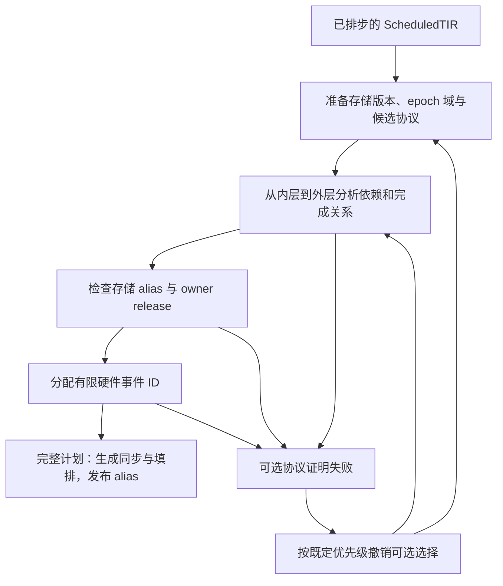

# 910B InsertSync 算法阅读说明

`InsertSync` 实际负责一整套同步计划：证明任务的完成顺序，选择实现这些顺序的
协议，证明事件位不会被过早复用，验证存储复用，分配有限的硬件事件，最后生成
同步指令。它接收已经排好 Stage、确定存储版本的 ScheduledTIR；它不负责选择
FA 分块，也不重新搜索任务排步。

算法难读的主要原因是：**数据依赖、硬件事件生命周期和存储生命周期三种证明，
与若干替代同步协议的选择交织在了一次递归分析里。** 循环、guard 和双 AIV
确实需要细致处理，但重复识别协议、一个对象承载多个规划阶段、证明与重试混合，
属于实现的组织问题。本轮已将生命周期求解改成返回结果、区分待父层证明与
已证明状态，并将硬件分配结果移出同步点；下文按当前实现说明。

本文先建立完整流程，再给源码阅读顺序。硬件及 lowering 契约见
[编译器契约](ascend_910b.md)，具体事件规则见 [local events](ascend_local_events.md)。

## 1. 先分清三个问题

| 问题 | 要证明的关系 | 证明成功后允许做什么 |
| --- | --- | --- |
| 数据完成 | 写已完成才能读；旧读已完成才能覆盖 | 执行依赖任务，或省去已被其他路径保证的同步 |
| 事件生命周期 | 同一个事件位再次 Set 前，旧 Wait 已消费它 | 缩减事件版本，或让两个协议共享 ID |
| 存储生命周期 | 要复用的物理区域上，所有相关旧访问均已结束 | 再次覆盖某个 slot，或让不同分配共享物理存储 |

三者可以互相提供证据，但不能相互替代。尤其需要区分：

- `WaitFlag(V_S)` **能**证明匹配 Set 所覆盖的 Vector 操作完成。
- Scalar 消费这个 flag 后才派发下一次 notification，还能证明事件位的生命周期。
- 后一个推论本身不会额外证明其他 Vector 读完成，也不授权任意 buffer alias。

另外，保护“这一个 slot 可以被覆盖”，不一定证明“整个子循环已经结束”。
父循环中其他 slot 的访问仍可能在进行。

## 2. 用一个最小流水理解算法

设 `W(i)` 写入某个物理 slot，`R(i)` 读取它；slot 环宽为 `B`：

```text
W(i) 完成 ──ready──> R(i) 开始
R(i) 完成 ──release──> W(i+B) 开始
```

这两条关系保护数据。接下来还要回答：实现 ready/release 的 flag ID 如何轮换？
循环只运行一次、运行零次、跳过某些迭代时，初始 token 和最后 drain 如何配对？
这些属于事件协议的有限执行问题。

因此有三个独立的数量：

| 数量 | 含义 |
| --- | --- |
| Stage 偏移 | 任务在第几次物理迭代发射 |
| buffer 版本数 | 分配多少个物理存储 slot |
| flag 版本数 | 分配多少个事件 ID 来避免通知重叠 |

它们不能直接互相代用。数据有两个 slot，并不自动证明两个事件位足够；某个
Scalar wait 能把事件宽度缩成一位，也不表示数据 slot 可以缩成一个。

## 3. 整个 pass 如何运行



图中的重试只适用于可撤销的优化选择。必要的完成证明或必需的物理 alias
最终无法成立时，编译必须拒绝，不能加一个模糊的 barrier 或忽略失败。

对应源码的四个入口：

1. `KernelSyncPreparation`：准备树、版本/epoch 事实、候选协议及重试输入。
2. `TryPlanKernelSync`：新建分析器，完成依赖/alias/release 证明，然后分配事件。
3. `PlanKernelSync`：解释失败原因，决定撤销什么并重新分析。
4. `MaterializeKernelSync`：只消费已经通过所有检查的完整计划。

同一轮失败分析的闭包、事件分配和 alias 结果不能带入下一轮。

## 4. 核心递归：一个循环内发生什么

先读 `SyncAnalyzer::AnalyzeNodeList`。它是算法主线，以下伪代码保留了实际顺序：

```text
analyze(scope):
    分析所有 child
    把 child 可以合法投影的完成关系加入当前闭包

    收集本 scope 的依赖；扣除已有协议覆盖的具体义务
    加入同 pipe 的发射顺序
    去掉被完整子协议覆盖的父协议
    去掉已有闭包保证的同步关系

    为符合条件的 counter 读者补真实完成事件
    证明本层事件的版本宽度、初始 token 和 drain
    用本层闭包解决 child 暂存的单次循环生命周期义务

    固定本层同步点
    计算兄弟/父子协议之间可否共享 flag ID
    记录供存储生命周期使用的顺序关系

    保存本 scope 完整闭包
    向父层返回可投影的零距离关系和可见同步点
```

这里有两个很容易误读的地方：

- child 的“一次迭代”不等于 parent 的“一次迭代”。不能直接把所有带距离的
  child 边搬到 parent。普通闭包向上传播保留零距离关系；跨层 slot 保护和
  完整子协议覆盖要另行证明。
- 有些 child 自己只执行一次，但 parent 会反复进入它。child 无法独立证明
  同一 flag 下次使用之前已经被消费，所以会把待解决的义务交给 parent。
  `ResolveSingleIterationBinaryPoints` 处理的就是这件事。

## 5. 图里的边究竟表示什么

可以把一条 `DepEdge(src, dst, distance, strict)` 读成：

```text
在同一个可组合的 epoch 时钟中：src(i) 在 dst(i+distance) 之前
```

`strict` 区分完成关系和较弱的发射顺序。具体查询还会考虑架构允许的同 pipe
隐式完成规则；不能把所有同 pipe 顺序都当作完成。

节点 `SyncInsertionSite` 同时描述两种位置：

- `path_begin`：从当前分析层看，这个位置属于哪一个 child。
- `path_end`：实际插入同步的任务或控制边界。

除此之外还包含 core、pipe、epoch domain 和 guard。同一个物理任务在不同
作用域、不同 epoch 域下可能对应不同 site。域投影必须证明时钟/激活兼容；
“两个节点看起来是同一个任务”不足以合并。

site 收集只枚举一次 task/path/core/domain，先确定规范 ID，再按 key 解析父层 ID。
同一物理 site 在一个 domain 下只能对应一个父位置，冲突检查仍保留。分析某层时
直接取已排序 site 表中的 scope 区间，不再重新遍历该层全部 task 和 epoch domain。

当前有两套图查询，不能直接理解成完全重复：

| 结构 | 查询与用途 |
| --- | --- |
| `DepClosure` | 枚举有界迭代距离的闭包；查询指定距离是否存在、最小完成距离等，服务删边、协议和事件证明 |
| `IterationOrder` | 带完成状态的非负加权可达性；查询不受上述枚举上限限制的最小距离，服务存储生命周期 |

`RecordLifetimeOrder` 会把已经确认的关系交给后者，并补上超过闭包枚举范围的
原始同 pipe 顺序。两者目前重复维护了部分关系，这是可改进的地方；但
**指定距离可达**与**最小距离可达**不是同一个问题，不能无证明地换成一个最短路。
条件激活和 counter 时钟尤其不能靠数值距离相同就组合。

## 6. 为什么时钟会有这么多种

| 情形 | 时钟含义 | 需要防止的错误 |
| --- | --- | --- |
| 普通词法循环 | 按循环坐标推进 | 忽略非零起点、步长、空循环 |
| 带 Stage 的任务 | 物理迭代减去 Stage 后的逻辑坐标 | 把发射顺序误当成相同逻辑代次 |
| 带条件的激活 | 只在 guard 成立的代次执行 | 把带空洞的执行序列当作连续区间 |
| counter 版本 | 按实际完整 owner 激活递增 | 跳过 owner 时仍假定 counter 前进，或允许不匹配的 tick |
| 嵌套循环 | task/query/chunk 等不同层的代次 | 把内层距离或一次执行误当作外层生命周期 |

`AnalyzeLexicalEventClock` 只统一“边界不可变、步长为正”这部分。
它不证明所有时钟等价，也不证明某个 guard 的激活区间连续。

大量 guard、单次循环、Stage 和 counter 检查的由来，是为了确定每一次真实
Set/Wait、读/写属于哪一个代次，并保证空执行和重复进入时仍然匹配。

## 7. 为什么已有硬件协议还要进入分析

编译器可能用更具体的机制满足一条依赖，而不再发普通的整任务同步：

| 机制 | 提供什么 | 不能扩大成什么 |
| --- | --- | --- |
| unit flag stream | 选定 MAD/FIX 流的协议保证 | 任意任务或任意存储的完成关系 |
| operand slot credit | 指定物理 slot 的读者释放 | 整个父 phase 已完成 |
| owner readiness | 对应 owner 的输入/结果就绪 | 全部 AIV 参与者已完成 |
| GM read-release / write-acquire | 精确读释放或写入许可 | 被移动前的整个宽边界完成关系 |

`CollectSyncPoints` 需要知道哪些义务已经被这些机制覆盖。
owner 输入/结果的精确 RAW 在每轮 analyzer 构造时索引一次，查询键包括存储、
producer/consumer、作用域、距离以及两端 core。依赖收集不再分别扫描两个协议
列表；它只消费覆盖事实，不向完成闭包增加边。unit stream、slot credit 和
GM cut 的证明强度不同，仍保留各自处理，未强行套进通用规则系统。

`SyncPointProof` 用于避免把已经移动到局部访问的端点，继续当成原来的宽完成边。

当前的 `ParentMemoryCycle` 则把一类重复判断收敛成：

```text
作用域 + 存储
  → 唯一完整 writer / reader
  → 合法词法遍历或真实 counter 推进
  → 保留的 ready / release 环与完成路径
  → 可覆盖的具体 RAW / WAR / WAW
```

证明按作用域和存储计划保存一次。词法循环覆盖 WAR 和 operand WAW；counter
循环还可覆盖被完整新写杀死的旧 RAW。它只允许跳过匹配的存储义务，不向父层
闭包添加虚构的整体完成边。相关合法性检查仍在，减少的是反复扫描和证明。

### 重复模式如何匹配

`MatchTaskBody<Node>` 只穿过 `tl.ascend_task` marker，随后匹配一个原子节点；
条件、循环、序列和其他属性不会被当成透明包装。`MatchTaskCall` 在此基础上
匹配 `Evaluate(Call)`，供 typed-operation 识别共用；core、Stage 和操作种类
仍由使用者检查。允许任意属性的旧路径不套用这个更严格的 matcher。

`IsCounterElement` 统一匹配同一个 buffer 的无 predicate 单元素 `[0]` 访问。
初始化还须匹配值零，推进还须匹配左操作数为该读取、右操作数为一的加法；
不能把交换操作数或其他代数等价式直接当成 canonical counter 更新。

### 事件生命周期如何交付结果

`PlanFlagLifetime` 按值接收一个同步点，在本地完成推导后返回更新的同步点，
或返回 `FlagLifetimeFailure`。`OptimizeFlagVersions` 统一应用结果或请求重试。
求解器不修改 analyzer 的重试状态，也不额外复制一份“宽度、时钟、协议”的
结果结构再逐字段转写。是否还需要父层证明由同步点自身的生命周期状态表示。

`SyncPoint::binary_lifetime` 使用互斥状态表示普通环、有限/移位环、待父层证明、
父层已证明。父层解决义务后直接转成 `ParentBoundBinaryLifetime`，不再保留
一个需要另查 `validated` 的待验证对象。到根层仍有未解决义务就拒绝。
已由父层证明的事件仍不参加普通跨通道 ID 共享；删除待验证字段不改变这一限制。

## 8. 为什么要回退重试

可选优化之间有真实耦合。例如，一个普通 collective 边可能同时：

1. 保证某个数据依赖；
2. 给另一个 flag 提供反向完成路径；
3. 给某个物理存储 alias 提供释放证据。

改成更窄的 owner/GM 协议后，第一个依赖仍然正确，后两个证据却可能消失。
因此，局部替换合法并不等于整个同步计划合法。

`TryPlanKernelSync` 先检查这些证明，再检查有限事件容量。
`KernelSyncSelection` 根据失败种类选择撤销哪个可选机制。证明失败和容量失败
不一定采用同一撤销顺序。需要重新准备树的选择走 root 重试，其余重建分析尝试。

这部分可以改进为更明确的“哪个选择依赖哪个证明”，但直接删除重试、统一回退
到最保守协议，会改变可接受程序或性能。

## 9. 分配和生成是最后两步

`FlagReuseAnalysis` 先证明哪些逻辑事件可以共享 ID；`FlagAllocator` 再分配
真实 ID。910B 本地 hard-event 域只有有限的 8 个 ID，跨核基础 ID 空间为 16 个，
还要避开用户显式占用和已保留的 slot credits。事件宽度和共享关系会直接影响
可否分配成功。

普通事件与 owner readiness 共用显式 flag 占用掩码和连续区间搜索。普通事件仍
从低 ID 分配，owner readiness 从高 ID 分配；result 仍先于 input，因此不会
通过改变分配顺序换取代码缩减。owner 输入/结果共用释放验证和事件构造，方向
决定两端 core 与 owner 坐标；只有输入方向生成另一个 AIV 的配对贡献。

分配器只读同步点，将“同步点索引 → allocation 索引”保存在自己的数组中。
`SyncPoint` 不再携带由后续分配阶段回写的硬件索引；materializer 同时读取
已证明同步点与分配映射。无需硬件 flag 的同 pipe 路径不访问该映射。

`SyncMaterializer` 随后按已接受计划生成 Set/Wait、必要的同 pipe barrier、
owner/slot 操作及填排，并把同步放到实际 core/task/guard 位置。
源码排在某个 task 前后，还不够保证 PerCoreTask 内部每个真实候选执行都正确，
所以 materialization 也有位置和参与者验证。

## 10. 哪些复杂度值得继续消除

| 必须保留的事实 | 当前可以改进的表达 |
| --- | --- |
| 发射、完成、事件消费不是同一种关系 | 让关系类型更明确，减少每个使用者重新判断的布尔条件 |
| 多种时钟不能任意组合 | 集中验证时钟与投影，避免不同消费者重复解读同一循环 |
| 协议只保护特定访问和参与者 | 用明确的覆盖证明供依赖分析消费，减少对各协议内部结构的了解 |
| 有限 flag 容量和 seed/drain 匹配 | 将完成后的事件计划与未解决的生命周期义务区分清楚 |
| 可选协议会相互影响 | 显式记录证明依赖，减少由多个 fallback 状态变量间接表达的关系 |

当前 `SyncPoint` 仍保存依赖、时钟、事件宽度与局部协议；生命周期状态已互斥，
分配结果已独立，但整个同步点尚未拆成 draft/final 两种类型。`AnalyzeNodeList` 又同时承担闭包、
协议覆盖、事件宽度、共享和存储顺序。这是阅读负担的重要来源。

继续简化应以减少这些交叉依赖为目标。移动类、缩短入口或合并检查，尚不足以
证明整个算法已经简化。删除 guard/counter/参与者检查则可能只是缩小功能范围。

## 11. 推荐源码阅读顺序

主文件：[insert_sync.cc](../../src/ascend/transform/insert_sync.cc)。按函数名搜索，
无需从文件头开始顺读。

| 顺序 | 入口 | 首次阅读只回答这个问题 |
| --- | --- | --- |
| 1 | `InsertKernelSync`、`TryPlanKernelSync` | 一个完整计划要通过哪些关口？ |
| 2 | `AnalyzeNodeList` | 子循环如何交付事实，本层按什么顺序处理？ |
| 3 | `CollectSyncPoints`、`IsParentMemoryCovered` | 哪些依赖还需要新的协议？ |
| 4 | `DepClosure`、`OptimizeSyncPoints` | 哪些关系已有保证，可以省去同步？ |
| 5 | `PlanFlagLifetime`、`ResolveSingleIterationBinaryPoints` | 每个事件自身何时能再次使用？ |
| 6 | `FlagReuseAnalysis`、`FlagAllocator` | 不同事件何时能共用有限 ID？ |
| 7 | `MaterializeKernelSync`、`SyncMaterializer` | 计划如何落到实际指令与填排？ |

首次阅读可以把 `ContiguousLocalBinarySpan`、`ClosedFullMemoryAccesses`、
`ClosedOperandCounter` 当成返回成功/失败的独立证明器。先理解它们的输入、
输出和使用者，再查看内部的溢出、完整访问、guard 和 tick 检查。
